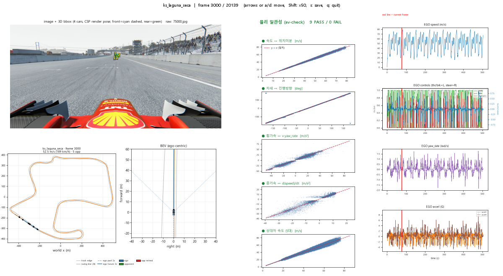

# Summer_USRG Validation

`Summer_USRG`에서 수집한 Assetto Corsa 데이터가 실제 화면과 차량 운동에 맞는지 확인하는 도구 모음이다. 원본 run을 수정하지 않고 이미지, 3D bounding box, BEV와 물리 채널을 함께 살펴본다.

수집 코드는 메인 저장소에 있다.

- [Summer_USRG](https://github.com/songdavid0206/Summer_USRG)

## 무엇을 확인하나

- CSP actual camera pose로 투영한 상대차 3D bounding box
- 같은 render tick에서 기록한 차량 position, forward/up과 visual AABB
- 전체 트랙과 ego-centric BEV
- Racing line, track edge, FOV와 상대차 위치
- Telemetry speed와 world-position 미분 속도
- Yaw와 실제 진행방향
- 종·횡가속도와 독립 물리식
- 상대차 기록 속도와 위치 미분 속도
- Retired/invalid 차량과 이상 frame

Bounding box를 이미지에 맞춰 조정하지 않는다. 게임에서 기록한 camera와 vehicle 3D state로 먼저 투영하고, RGB는 그 결과를 확인하는 독립 자료로만 사용한다.



## 설치

두 저장소를 같은 상위 폴더에 clone하는 구성이 가장 간단하다.

```text
workspace/
├─ Summer_USRG/
└─ Summer_USRG_Validation/
```

PowerShell:

```powershell
git clone https://github.com/songdavid0206/Summer_USRG.git
git clone https://github.com/songdavid0206/Summer_USRG_Validation.git

cd Summer_USRG
python -m pip install -e ".[capture]"

cd ..\Summer_USRG_Validation
python -m pip install -e .
```

`ac_validation`은 좌표 변환과 차량 제원 처리에 `ac_dataset`을 사용한다. 그래서 메인 저장소를 먼저 설치해야 한다. 저장소를 update한 뒤 명령이 보이지 않으면 각 폴더에서 editable install을 한 번 더 실행한다.

## 빠른 시작

원본 run 검사:

```powershell
av-check ..\Summer_USRG\dataset\<run_id>
av-view  ..\Summer_USRG\dataset\<run_id> --frame 0
```

정적 BEV 저장:

```powershell
av-bev ..\Summer_USRG\dataset\<run_id> --frame 350 --view both
```

`dataset_v2` multi 세션은 별도 viewer를 사용한다.

```powershell
av-view-v2 ..\Summer_USRG\dataset_v2\multi\<session> --frame 3000
```

## 명령

### `av-view`

원본 run을 frame 단위로 살펴보는 viewer다.

```powershell
av-view ..\Summer_USRG\dataset\<run_id> --frame 350
```

화면에는 RGB와 3D box, 전체 트랙, ego BEV, control timeline과 물리 검사 결과가 같이 표시된다.

| 키 | 동작 |
|---|---|
| `←`, `→` 또는 `a`, `d` | 한 frame 이동 |
| `Shift+←`, `Shift+→` 또는 `A`, `D` | 50 frame 이동 |
| `Home`, `End` | 처음 또는 마지막 frame |
| `s` | 현재 화면 저장 |
| `q` | 종료 |

주요 옵션:

```text
--frame N       시작 frame
--step N        이동 간격
--fov DEG       수평 FOV 수동 지정
--camera N      fallback onboard camera index
--tau-ms N      game-time 정보가 없는 구 run의 수동 시간 보정
```

최신 run은 실제 CSP camera pose와 game time을 사용하므로 보통 `--fov`, `--camera`, `--tau-ms`를 지정하지 않는다.

### `av-check`

물리 채널을 수치로 교차검증하고 PNG와 JSON 보고서를 만든다.

```powershell
av-check ..\Summer_USRG\dataset\<run_id>
```

출력 폴더 지정:

```powershell
av-check ..\Summer_USRG\dataset\<run_id> -o validation_output
```

생성 파일:

```text
physics_report.png
summary.json
```

검사 방식:

| 기록값 | 비교 기준 |
|---|---|
| Ego speed | World position 중앙차분 |
| Body yaw | 위치 변화로 계산한 진행방향 |
| `accelX × g` | `speed × yaw_rate` |
| `accelY × g` | `d(speed)/dt` |
| Opponent speed | Opponent world-position 중앙차분 |

`summary.json`에는 각 검사의 PASS/FAIL, sample 수, 기울기, 상관, residual 통계와 이상 frame이 들어간다.

### `av-bev`

GUI 없이 지정 frame의 BEV만 저장한다.

```powershell
av-bev ..\Summer_USRG\dataset\<run_id> --frame 350 --view both
```

`--view`는 `ego`, `global`, `both` 중 하나다.

### `av-view-v2`

Structured `dataset_v2/multi` 세션을 읽는 viewer다. ZIP으로 전달받았다면 먼저 전체 압축을 푼다.

지원 세션에는 다음 파일이 있어야 한다.

```text
<session>/
├─ FRAME_INDEX.csv
├─ image_index.parquet
├─ render_car_state.parquet
├─ TRACK_INFO/
├─ INTERACTIONS/
└─ NON_INTERACTION/
```

Interaction clip에 중복된 frame과 non-interaction frame을 `time_ms`로 합쳐 원래 세션 순서로 보여준다. V2의 `steer_angle`은 degree가 아니라 `[-1,1]` command이므로 `steer(norm)`으로 표시한다.

모듈로도 실행할 수 있다.

```powershell
python -m ac_validation.viewer_v2 ..\Summer_USRG\dataset_v2\multi\<session> --frame 3000
```

## 3D projection

이미지별 camera state:

```text
cam_pos_*
cam_forward_*
cam_up_*
cam_fov_deg
```

Forward/up을 정규직교화해 world-to-camera extrinsic을 만들고, image 크기와 vertical FOV로 intrinsic을 계산한다. 최신 run에서는 같은 CSP callback에서 기록한 상대차 position, forward/up과 visual AABB로 full 6DoF cuboid를 만든다. 경사나 연석에서 차체가 기울면 box도 같이 기울어진다.

시간 정합을 볼 때는 다음 residual을 먼저 확인한다.

```text
cam_pose_game_delta_ms
cam_packet_render_error
car_state_age_ms
```

최신 데이터에서는 값이 0에 가깝고 연속적이어야 한다.

## 결과를 볼 때 주의할 점

- Formula car는 wheel과 wing이 돌출돼 하나의 cuboid가 silhouette에 완전히 맞지 않는다.
- Wireframe은 가려진 모서리도 그리기 때문에 먼 차량이 겹쳐 보일 수 있다.
- 경사진 box가 반드시 오류는 아니다. Full 6DoF body pose를 반영한 결과일 수 있다.
- `retired=True` 또는 `valid=False` 차량은 학습 후보에서 제외한다.
- AC의 `accelX`, `accelY`는 g 단위라 검사에서 `9.80665`를 곱한다.
- RGB와 잘 맞는 box는 image fitting 결과가 아니라 독립 3D state가 일치한다는 증거여야 한다.

## 코드 구조

```text
src/ac_validation/
├─ loader.py          원본 run loader
├─ loader_v2.py       dataset_v2 multi loader
├─ projection.py      3D cuboid projection
├─ bev.py             Ego/global BEV
├─ viewer.py          원본 run viewer
├─ viewer_v2.py       dataset_v2 viewer
├─ checks.py          물리 검사
└─ report.py          PNG/JSON report
```

## 테스트

게임과 실제 dataset 없이 실행된다.

```powershell
python -m unittest discover -s tests -p "test_*.py"
```

또는:

```powershell
python -m pytest -q
```

현재 지원 범위는 single-run 시각 검사와 물리 검사, `dataset_v2` multi viewer다. 여러 run을 한 번에 비교하는 batch report와 RGB black/blur/UI 노출 검사는 아직 별도 작업으로 남아 있다.
